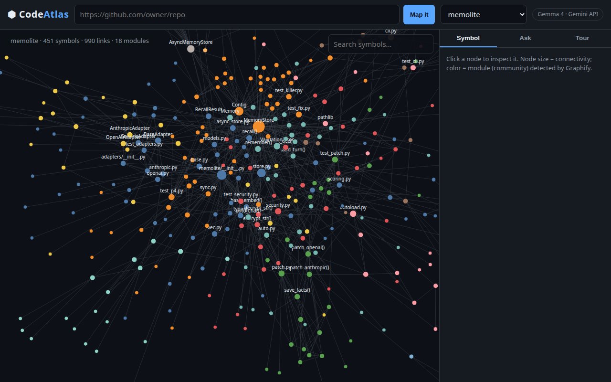
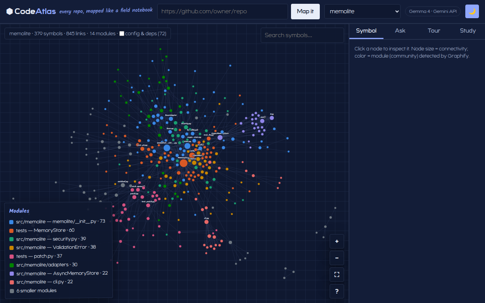
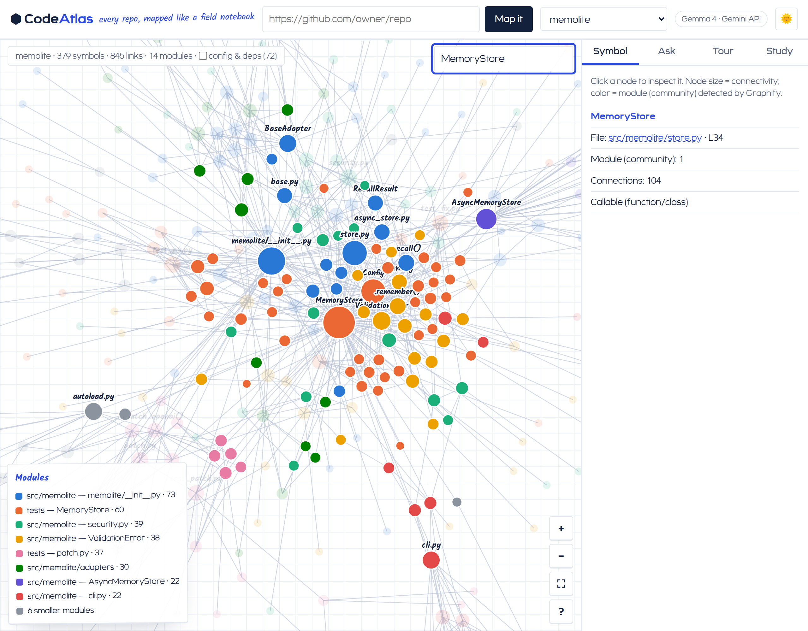
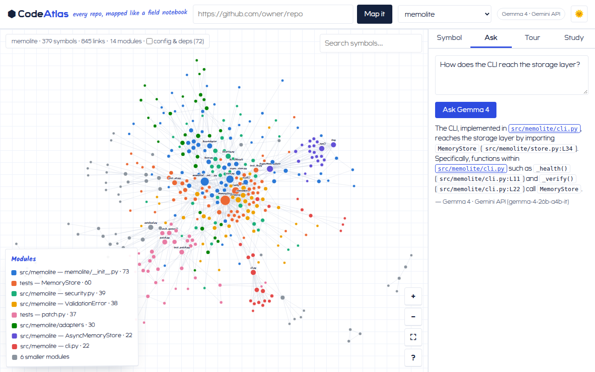
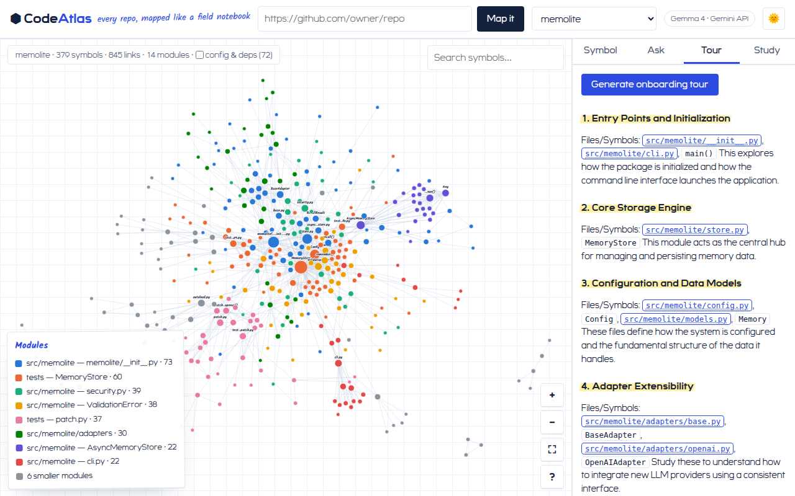
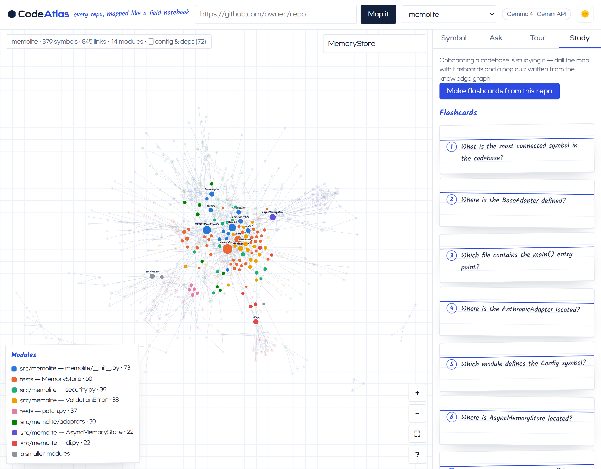

# CodeAtlas

[](https://github.com/mastaan66/codeatlas/actions/workflows/ci.yml)
[](LICENSE)
[](package.json)

**Every codebase greets a newcomer the same way: ten thousand files and no map.** The README went stale the week it was written. Grep hands you trees, never the forest. You read `store.py` on Monday and can't place it by Thursday. And now coding agents wait in the same queue, burning their context windows rediscovering the same architecture on every single task.

**So we built the map.** CodeAtlas turns any repo into a living knowledge graph — parsed locally from the AST in seconds, no LLM needed to build it — and opens four doors into that one ground truth: an atlas you explore, a Gemma 4 guide who cites `file:line` and can't invent symbols, flashcards that make the architecture stick, and an installable skill that hands the whole map to your coding agent.


```
inputs                     ground truth                 surfaces
──────                     ────────────                 ────────
GitHub repo URL ──▶ graphify extract ──▶ graph.json ──▶ Map    (d3 atlas · humans explore)
                    tree-sitter AST,        │       ├─▶ Ask+Tour (Gemma 4 · humans learn)
                    local, no LLM           │       ├─▶ Study  (flashcards+quiz · humans drill)
                                            │       └─▶ repo-tour skill (docs · coding agents)
photo of notes ──▶ study/ SnapStudy ─ multimodal Gemma 4 ─▶ summary · flashcards · quiz (EN+తెలుగు)

engine: Gemma 4 — Gemini API (hosted) ⇄ Ollama (open weights, offline) · deployed on Cloudways
```

Built at Hacktoberfest Hack Day Hyderabad × AI Community Hyderabad, 31 Oct 2026.

## For the judges

| Track | Where to look |
|---|---|
| **Best Use of Graphify** | The knowledge graph is the product's ground truth: [`lib/indexer.js`](lib/indexer.js) builds it (`graphify extract --code-only`), [`public/app.js`](public/app.js) renders it, [`lib/graphContext.js`](lib/graphContext.js) grounds every Gemma prompt in it, and [`agent-skill/scripts/analyze_graph.py`](agent-skill/scripts/analyze_graph.py) turns it into onboarding docs |
| **Best Use of Gemma 4** | All reasoning is Gemma 4 — `gemma-4-26b-a4b-it` via the **Gemini API** ([`lib/gemma.js`](lib/gemma.js)); multimodal image→study-kit in [`study/lib/gemma.js`](study/lib/gemma.js), multilinguality demonstrated in English + Telugu |
| **Best Open-Source AI Project** | MIT-licensed; ships an **installable agent skill** ([`agent-skill/`](agent-skill/)); every surface runs **fully offline on open-weight Gemma 4 via Ollama** when no API key is set |
| **Best Use of Cloudways** | Built for Cloudways Velocity (Node preset, env-config, bundled seed graphs so the demo works even where the Graphify CLI can't install) — deploy steps and graceful-degradation table in [`DEPLOY.md`](DEPLOY.md); live URL added at demo time |

Proof of work: 40 automated tests across three CI jobs (all offline, no API keys), real incremental commit history from event day, demo videos below.

## 15-second quick start

```bash
# 1. the atlas
npm install
cp .env.example .env     # optional GEMINI_API_KEY — without it, local Ollama gemma4 serves
npm start                # → http://localhost:3001

# 2. the agent skill
cd agent-skill && ./install.sh       # Claude Code + opencode; then say "give me a tour of this repo"

# 3. the study hall (photo → flashcards)
cd study && npm install && npm start # → http://localhost:3002
```

Requires Node ≥ 20 and `git`; live indexing needs the Graphify CLI (`uv tool install graphifyy`); offline mode needs Ollama with `ollama pull gemma4`.

## The pain, door by door

| You say | CodeAtlas answers with | How it solves it |
|---|---|---|
| *"Where do I even start?"* | **Map** | a force-directed atlas of the real structure — color = module, size = connectivity; search, Meet-style fly-to-focus, click any symbol through to its source. Config noise (manifests, CI yaml, lockfiles) folds behind a toggle, so modules mean architecture, not plumbing |
| *"How does the CLI reach the storage layer?"* | **Ask + Tour** | Gemma 4 answers **from the graph** — `file:line` citations, forbidden from inventing symbols, honest when the graph can't say — plus a one-click onboarding tour from entry points to your first change |
| *"I read it. Will I remember it?"* | **Study** | flashcards and a pop quiz written *from the graph* — onboarding a codebase is studying it. And [`study/`](study/) extends the same idea to paper: photograph handwritten notes or a whiteboard, get the same study kit back, in English or తెలుగు |
| *"My agent re-reads the repo every task"* | **repo-tour** | an installable agent skill that writes `ONBOARDING.md`, `ARCHITECTURE.md` (mermaid module diagram) and `GOOD-FIRST-SPOTS.md` from the graph once — real committed output at [`agent-skill/examples/memolite/`](agent-skill/examples/memolite/) |

Four doors, one [Graphify] ground truth: the graph is built once, locally, and every surface — human or agent, online or offline — reads from it.

## Motion that means something

Every animation answers a user action — nothing wiggles for decoration:

- **Meet-style focus** — click a symbol (or hit Enter in search) and the camera flies in to frame it with its neighbors, the way a meeting spotlights the speaker; `Esc` or a double-click on the canvas pulls back to the full map.
- **Spotlight hover** — rest on a node and its neighborhood lights up while everything else fades, so you read one dependency story at a time.
- **Auto-fit** — the graph frames itself as the force layout settles; `⛶` re-fits anytime.
- **Index-card flips** — Study flashcards flip in 3D like the real thing; the correct quiz answer gets an animated highlighter sweep, straight off the Lumenar notebook.
- **Theme flip** — one click between the paper notebook and the night notebook, persisted per device.

All of it collapses to instant, motion-free states under `prefers-reduced-motion`.

## Demos

**Product walkthrough (55s)** — map → spotlight → file viewer → graph-grounded answer → tour → theme flip.

https://github.com/user-attachments/assets/aeb6b9ae-b3ad-4771-b974-554ca48613c3

**Test run (47s)** — all three suites green, fully offline.

https://github.com/user-attachments/assets/11501f70-7ba3-409b-bc97-5a226841c2db

## Screenshots

**Explore** — memolite mapped; Lumenar "engineer's notebook" design in the paper notebook…



…and the night notebook.



**Symbol** — click any node for its file, module, connectivity and a jump to source.



**Ask** — Gemma 4 answers from the graph, with file:line citations.



**Tour** — one-click numbered onboarding tour generated from the graph.



**Study** — flashcards and a pop quiz written from the same graph.



## Tests

40 tests, three CI jobs, zero network: **19** on `node:test` for the atlas (URL/injection validation, seed-graph integrity, grounded-context builders, live API integration on an isolated port, path-traversal rejection for the file viewer and study kit), **12** for `study/` (strict-JSON parsing, upload validation, provider-failure survival), **9** on `unittest` for `agent-skill/` (synthetic + real 451-node graph fixtures). LLM calls are stubbed out by blanking the key and pointing Ollama at a dead port.

```bash
npm test                                           # atlas (19)
cd study && npm test                               # study hall (12)
cd agent-skill && python3 -m unittest discover -s tests  # agent skill (9)
```

## Scalability

- **Stateless server** — graphs, tours and study kits cache on disk keyed by repo slug; the data dir can move to shared storage, so instances scale horizontally.
- **Bounded payloads** — graphs trim to the top 4,000 symbols by connectivity before serving; a monorepo can't blow up the browser.
- **Cheap indexing** — local AST parsing with zero model calls; shallow `--no-tags` clones with a size fence (413 beyond `MAX_CLONE_MB`), per-URL in-flight locks and per-IP rate limiting on `/api/index`; tours and study kits cache on disk (ask is answered live).
- **Model-agnostic edge** — provider and model are env-switchable (`GEMINI_API_KEY`, `GEMMA_MODEL`, `OLLAMA_URL`, `OLLAMA_FALLBACK`).

## Security notes

- Repo URLs validated against a strict GitHub pattern; slugs sanitized; file viewer resolves paths inside the repo dir only (traversal-tested), 200 KB cap, binaries refused.
- All child processes use `execFile` with argument arrays — no shell interpolation. Cloned repositories are **parsed, never executed**.
- No secrets in the repo: `.env` is gitignored everywhere; CI runs with the key blanked.

## Honest tooling disclosure

Built during the event with AI pair-programming (Claude Code); commits carry co-author trailers. Gemma 4 powers the product itself.

## License

MIT © 2026 [Mastan]

[Graphify]: https://github.com/Graphify-Labs/graphify
[Mastan]: https://github.com/mastaan66
