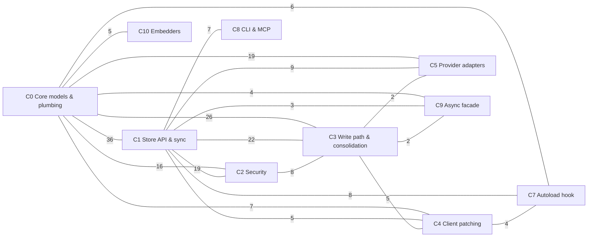

# Memolite — Architecture Map

*Generated by the **repo-tour** skill. Communities and edge counts come straight
from the Graphify knowledge graph (451 nodes, 990 edges, 18 communities,
commit `6c756fc`); nothing here is guessed.*

## The communities

### C0 — Core models & plumbing (79 nodes, `src/memolite`)
Top files: `models.py`, `vec.py`, `adapters/base.py`, `store.py`, `scoring.py`.
Key symbols: the package facade `memolite/__init__.py` (degree 58), `store.py`
module (44), `BaseAdapter` (`adapters/base.py:L11`), `MemoryStore.recall()`
(`store.py:L565`), `RecallResult` (`models.py:L54`). This is the data-model and
retrieval substrate everything else imports.

### C1 — Store API, sync & its test suite (63 nodes, `tests` + `src/memolite/sync.py`)
Home of the two biggest god nodes: `MemoryStore` (`store.py:L34`, degree 104)
and `Config` (`config.py:L10`, degree 42), plus `export_bundle()` /
`sync_files()` (`sync.py:L14`/`L143`). The heavy tests (`test_p4.py`,
`test_fix.py`, `test_killer.py`) cluster here because they hammer the store API.

### C2 — Security layer (42 nodes)
`security.py`: `encrypt_str():L98`, `decrypt_str():L114`, `harden_file():L38`,
`chain_hash():L65`; `._dec()` (`store.py:L82`) is the store's decryption hook.
Spec: `tests/test_security.py`. At-rest encryption and tamper-evident hashing.

### C3 — Write path & consolidation (39 nodes)
`MemoryStore.remember():L325`, `.add_turn():L201`, `.consolidate():L496`,
`Memory` (`models.py:L36`), `auto_chat()` (`auto.py:L72`), `ValidationError`
(`exceptions.py:L12`, degree 19). How memories get in and get merged.

### C4 — Client patching (38 nodes)
`patch.py`: `patch_openai():L72`, `patch_anthropic():L140`, `wrapper():L89`;
`save_facts()` (`auto.py:L19`); tested by `tests/test_patch.py` with `FakeOpenAI`.
Monkey-patches LLM clients so calls are remembered transparently.

### C5 — Provider adapters (30 nodes, `src/memolite/adapters`)
`AnthropicAdapter` (`anthropic.py:L10`), `OpenAIAdapter` (`openai.py:L10`),
`plug()` (`__init__.py:L18`), `.handle()` (`base.py:L44`),
`.handle_tool_use()` / `.handle_tool_calls()`. Tool-use plumbing per provider.

### C6 / C11 — CI workflows (26 + 14 nodes, `.github/workflows`)
`pages.yml` (site deploy) and `ci.yml` (test matrix). Self-contained.

### C7 — Autoload hook (25 nodes)
`autoload.py`: `_patch_instance():L55`, `_store():L41`, `install_hook():L114`,
`_off():L21`. Import-time auto-instrumentation; `tests/test_cli.py` covers its
CLI surface.

### C8 — CLI & MCP server (24 nodes)
`cli.py` with `main():L207` and friends; `mcp_server.py` with `run():L14` and
tools `remember()`/`recall()`/`health()`. The user-facing shell.

### C9 — Async facade (22 nodes)
`AsyncMemoryStore` (`async_store.py:L14`, degree 28) and `._run():L26`
(degree 18) which bridges every async method onto the sync store.

### C10 / C14 — Embedders (17 + 5 nodes)
`embedders.py` (`openai_embedder():L17`, `local_embedder():L36`,
`ollama_embedder():L51`) and the `Embedder` protocol (`embedder.py:L8`).

*(Smaller: C12 autoload tests, C13 pre-commit config, C15 examples, C16 docs
site JS, C17 pyproject.)*

## How the communities connect

Edge labels are inter-community edge counts from the graph (both directions
merged). CI, examples, and packaging communities have no cross-edges and are
omitted.

**Reading the shape:** C0 (models/plumbing) and C1 (store API) are the hubs —
every feature community (security, consolidation, patching, adapters, autoload,
CLI, async, embedders) attaches to one or both. The feature communities barely
talk to *each other* (the biggest feature-to-feature edge is C2–C3 at 8), which
means they can be understood — and changed — mostly independently.
