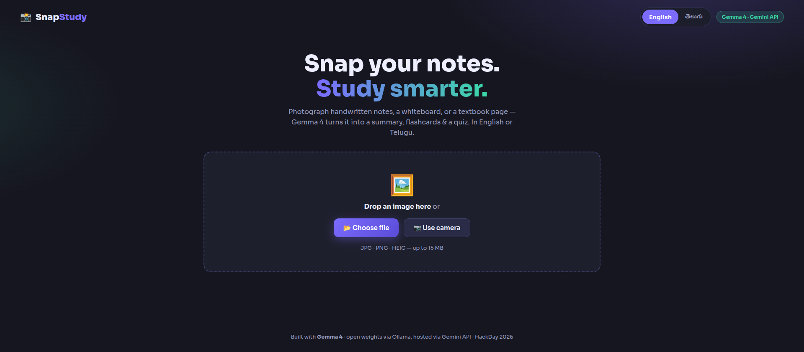
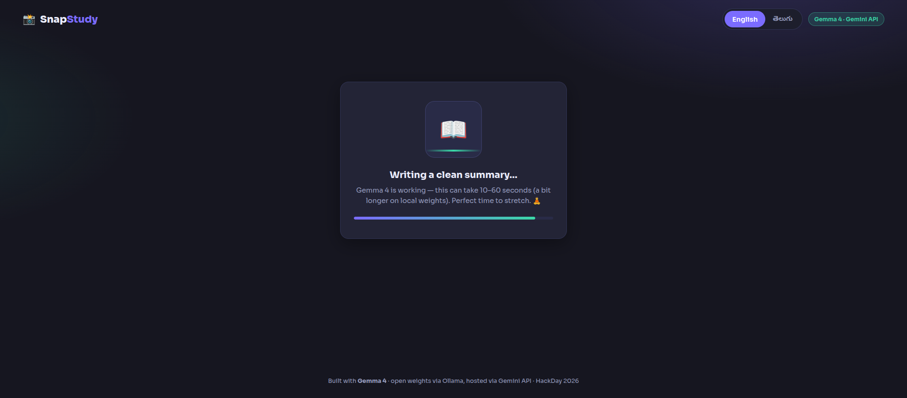

# 📸 SnapStudy

[](https://github.com/mastaan66/codeatlas/actions/workflows/ci.yml)

**Snap your notes. Study smarter.**

Point your phone at handwritten notes, a whiteboard, or a textbook page — SnapStudy uses **Gemma 4** (multimodal) to instantly turn the photo into:

1. 📝 a **clean summary**
2. 🃏 **flashcards** (click-to-flip)
3. 🎯 an interactive **multiple-choice quiz** with explanations and a score

…in **English or Telugu (తెలుగు)** with one toggle — Gemma 4 speaks 140+ languages, so learners can study in the language they think in.

## 🏆 Hackathon tracks

| Track | Why SnapStudy fits |
|---|---|
| **Best Use of Gemma 4** (flagship) | Gemma 4's multimodality (image → structured study kit) and multilinguality (English/Telugu toggle) are the entire product. |
| **Best Open-Source AI Project** | MIT-licensed, and runs fully offline on Gemma 4 **open weights** via Ollama — no API key, no cloud, no data leaves the laptop. |
| **Best Use of Cloudways** | Plain Node.js + Express app, deploys to a Cloudways server in minutes. |

## 🏗 Architecture

```
 ┌─────────────┐     multipart image      ┌──────────────────────────┐
 │  Browser    │ ───POST /api/study────▶  │  Express (Node 22)       │
 │  (vanilla   │   language=en|te         │  server.js + multer      │
 │  JS, 1 page)│ ◀──JSON {summary,        │                          │
 └─────────────┘    flashcards, quiz,     │        lib/gemma.js      │
   drag-drop /      provider}             └─────┬──────────────┬─────┘
   phone camera                                 │ 1. if key    │ 2. fallback
                                                ▼              ▼
                                  ┌──────────────────┐  ┌──────────────────┐
                                  │ Gemini API       │  │ Ollama (local)   │
                                  │ gemma-4-26b-a4b  │  │ gemma4:latest    │
                                  │ (hosted Gemma 4) │  │ (open weights,   │
                                  └──────────────────┘  │  fully offline)  │
                                                        └──────────────────┘
```

- **Automatic fallback chain:** Gemini API (if `GEMINI_API_KEY` set) → local Ollama with image → local Ollama text-only (with a clear UI notice). The UI badge always shows which provider answered: *"Gemma 4 · Gemini API"* or *"Gemma 4 · local open weights"*.
- **Strict-JSON prompting** with defensive parsing: markdown fences stripped, schema validated, one automatic retry on malformed output.
- No database, no build step, no framework — `express`, `multer`, `dotenv` only.

## 🚀 Setup

```bash
npm install
cp .env.example .env        # optional: add GEMINI_API_KEY for the hosted path
npm start                   # → http://localhost:3002
```

**Offline / open-weights mode (no key needed):**

```bash
ollama pull gemma4          # once (~9.6 GB)
npm start
```

### Environment variables (all optional)

| Var | Default | Purpose |
|---|---|---|
| `GEMINI_API_KEY` | – | Enables the hosted Gemma 4 path (faster) |
| `GEMMA_MODEL` | `gemma-4-26b-a4b-it` | Hosted model override (e.g. `gemma-4-31b-it`) |
| `OLLAMA_URL` | `http://localhost:11434` | Local Ollama endpoint |
| `OLLAMA_MODEL` | `gemma4:latest` | Local model tag |
| `PORT` | `3002` | Server port |

## 🔌 API

- `POST /api/study` — multipart: `image` (file), `language` (`en`|`te`) → `{summary, flashcards:[{front,back}], quiz:[{question, options[4], answerIndex, explanation}], provider, providerLabel}`
- `GET /api/health` — `{ok, provider, providerLabel}`

## 📱 Demo flow (60 seconds)

1. Open on a phone → **Use camera** → snap a notebook page.
2. Watch the Gemma 4 badge + friendly progress while it reads the page.
3. Flip through flashcards, take the quiz, see your score.
4. Hit **తెలుగు** — the whole study kit regenerates in Telugu.
5. Pull the network/API key — it still works on local open weights.

## 📷 Screenshots

**Upload** — drag-and-drop, file picker, or phone camera capture.



**Processing & results** — live provider badge, loading state, then Summary / Flashcards / Quiz tabs.



## 🧪 Tests

```bash
npm test        # node:test, zero extra dependencies
```

Fast (<1 s), fully offline: unit tests cover the strict-JSON hardening in `lib/gemma.js` (fence stripping, parse fallback, schema validation), and integration tests boot the real server on port 3102 with `GEMINI_API_KEY` cleared and `OLLAMA_URL` pointed at a dead port — so no AI provider is ever contacted — then verify `/api/health`, the 400 paths of `/api/study`, and that a full provider outage returns a graceful 5xx JSON error without crashing the server. CI runs the suite on every push and pull request (`.github/workflows/ci.yml`, Node 22).

## 📄 License

MIT © Mastan — see [LICENSE](LICENSE).
